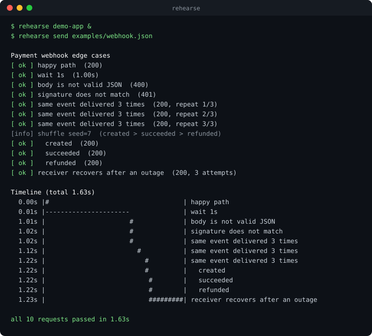

<div align="center">

# Rehearse

**Rehearse the worst day of your integrations.**<br>
Script webhook timelines, flaky APIs and network faults in one JSON file, then run them against `localhost`.

[](https://github.com/Sagar-Shahi/rehearse/actions/workflows/ci.yml)


[](LICENSE)



</div>

## Why

Your app talks to payment gateways, auth providers and other people's webhooks. The happy path is easy to test. The
questions that cause incidents are not:

- What if `payment.refunded` arrives **before** `payment.succeeded`?
- What if the provider returns a 500 on the **second** retry?
- What if the connection drops halfway through a response, or the same event arrives **three times**?

Today that means temporary mock code you forget to delete, or clicking "resend" in a dashboard. Rehearse turns each of
those situations into a file you can run, repeat, commit and share.

## Try it in 60 seconds

```bash
git clone https://github.com/Sagar-Shahi/rehearse && cd rehearse
python -m rehearse demo-app &                  # a sample webhook receiver on :3000
python -m rehearse send examples/webhook.json  # the run shown above
```

No install and no dependencies. Python 3.10 or newer is all you need. To get the `rehearse` command, run `pip install .`.

> [!TIP]
> Point `target` at your own app and change the paths to rehearse it for real. Run `rehearse init` to write editable copies of the examples.

## Three tools, one file format

| Command | What it does |
|---------|--------------|
| **`rehearse send`** | Pushes awkward events *at your app*: signed, corrupted, duplicated, delayed, reordered, with retries and expectations |
| **`rehearse serve`** | Runs a local API *your app calls* that fails on purpose: error sequences, latency, 3G throttling, dropped or cut-off responses |
| **`rehearse record`** | Captures real requests into a scenario file you can replay and share, timing included |

<details>
<summary><b>Example: send a timeline of events</b></summary>

```json
{
  "target": "http://localhost:3000",
  "vars": { "secret": "whsec_test_123" },
  "steps": [
    { "name": "happy path",
      "send": { "path": "/webhooks/payments", "json": { "id": "evt_{{uuid}}", "type": "payment.created" },
                "sign": { "secret": "{{secret}}", "format": "stripe" } },
      "expect": { "status": "2xx" } },

    { "wait": "2s" },

    { "name": "broken JSON arrives next",
      "send": { "path": "/webhooks/payments", "json": { "id": "evt_1", "type": "x" },
                "corrupt": "invalid_json", "sign": { "secret": "{{secret}}", "format": "stripe" } },
      "expect": { "status": [400, 422] } },

    { "name": "then the provider retries until you recover",
      "send": { "path": "/webhooks/flaky", "json": { "id": "evt_{{uuid}}" } },
      "retry": { "attempts": 5, "delay": "500ms", "until": { "status": 200 } } }
  ]
}
```

Built in: HMAC signing (Stripe, GitHub or plain hex), `corrupt` (truncate, invalid JSON, empty, garbage, bad signature),
`repeat` for duplicate delivery, `parallel` for races, `shuffle` for out-of-order events (the seed is printed so a
failing order can be replayed), `retry` that resends the *same* payload like a real provider, and `expect` on status,
body, latency or a specific network error.

</details>

<details>
<summary><b>Example: a third-party API that misbehaves on purpose</b></summary>

Change your app's base URL to `http://localhost:8080`. No changes to your source code.

```json
{
  "port": 8080,
  "routes": [
    { "match": { "method": "POST", "path": "/v1/charges" },
      "responses": [
        { "status": 500 },
        { "status": 503, "headers": { "Retry-After": "1" } },
        { "status": 200, "delay": "300ms", "json": { "id": "ch_{{uuid}}" } } ] },

    { "match": { "path": "/v1/customers/*" },
      "responses": [ { "network": "slow-3g", "json": { "id": "cus_1" } } ] },

    { "match": { "path": "/v1/refunds" }, "responses": [ { "fault": "drop" }, { "json": { "id": "re_1" } } ] },
    { "match": { "path": "/v1/events" },  "responses": [ { "json": { "data": [] }, "fault": "truncate" } ] }
  ]
}
```

Each route plays a **sequence** (500, then 503, then 200), and each response can add latency, a network profile
(`4g`, `3g`, `slow-3g`, `2g`, or your own latency, jitter and bandwidth) or a transport fault: `drop`, `reset`,
`truncate` (body cut off mid-stream), `garbage` (not HTTP) and `hang` (silence until your timeout fires). Set
`upstream` to proxy everything else to the real API, so you can add faults to real traffic. Your test code can read what
your client actually did from `GET /__rehearse/calls`.

</details>

<details>
<summary><b>Example: capture once, replay anywhere</b></summary>

```bash
rehearse record --port 9000 --out bug-4812.json              # point a webhook tunnel at :9000, trigger the bug
rehearse send bug-4812.json --target http://localhost:3000   # replay the exact sequence, timing included
```

The scenario file keeps bodies, headers and the gaps between requests. Commit it, attach it to the ticket, and everyone
reproduces the same sequence locally. Add `--forward URL` to relay requests to a real service while recording.

</details>

## Use it in CI

```yaml
- run: rehearse send scenarios/webhooks.json --target http://127.0.0.1:3000 --speed 10
```

Exit code `0` means every expectation held, `1` means one failed, `2` means the file was wrong. Add `--json` for
machine-readable results. `rehearse validate scenarios/*.json` catches typos before they run, and unknown keys are
errors with a "did you mean" hint.

## Documentation

- **[Scenario format reference](docs/scenario-format.md)**: every key, fault, network profile and variable
- [Contributing](CONTRIBUTING.md) and the [issue tracker](https://github.com/Sagar-Shahi/rehearse/issues)

<details>
<summary><b>How it compares to other tools</b></summary>

Rehearse does not replace these tools. It fills the gap between them.

| Tool | Great at | Where Rehearse differs |
|------|----------|------------------------|
| WireMock, Mountebank, MockServer | Rich stubbing, response sequences, fault injection | These need a JVM or Node runtime and their own stub formats, and they only mock *responses*. They do not send signed webhooks at your app |
| Toxiproxy | TCP-level network conditions for any protocol | It does not understand HTTP, webhooks or scripted payloads |
| Provider CLIs (Stripe CLI and similar) | Triggering one vendor's real test events | Rehearse is vendor-neutral and scripts *sequences* of corrupted, duplicated and reordered events |
| Postman, curl, Insomnia | Hand-testing endpoints | No timelines, no assertions about retry behaviour, no fault injection |
| ngrok, Hookdeck | Reaching localhost from the internet and replaying inbound requests | Complementary: tunnel into `rehearse record`, then replay offline |

What Rehearse adds is one dependency-free file format that drives **both** directions (events *to* your app, failures
*from* the APIs it calls) plus record and replay.

</details>

<details>
<summary><b>Known limits</b></summary>

Rehearse is an early release (0.1) built for local development and CI, not load testing.

- HTTP/1.x only. The mock server speaks plain HTTP (no TLS), one request per connection. The sender supports `https://` targets.
- Faults are injected at the HTTP-response level, not by a real network proxy. For packet-level conditions use Toxiproxy alongside it.
- Scenario files are JSON (no comments). Everything is configured in the file; there is no GUI yet.

</details>

<details>
<summary><b>Roadmap and good first issues</b></summary>

- [ ] A local web UI: a visual timeline editor on top of the same scenario files
- [ ] Import from HAR files and `curl` commands
- [ ] TLS for the mock server
- [ ] More signature formats (Slack, Shopify, Twilio) and a plugin hook for custom ones
- [ ] Probabilistic faults ("1 in 10 requests fails") for soak tests
- [ ] OpenAPI-aware mocking

</details>

## Development

```bash
python -m unittest discover -s tests -t .     # 74 tests, about 6 seconds, real local sockets
```

Standard library only. CI runs on Ubuntu and macOS with Python 3.10, 3.12 and 3.13.

## License

[MIT](LICENSE)
